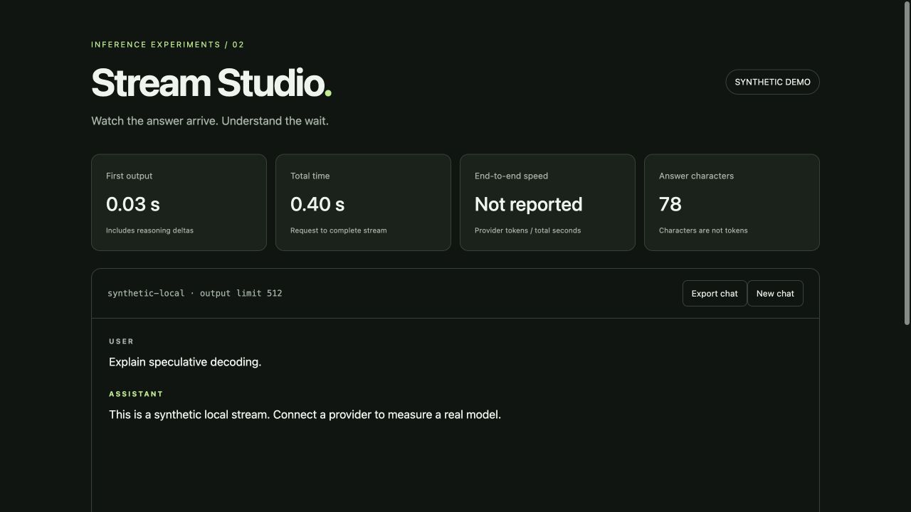

# Stream Studio



A local streaming chat interface that separates time to first output, total response time, provider-reported token rate, answer characters and reasoning text. Includes stop, new-chat and JSON export controls.

**Status:** new prototype created October 24, 2026 with AI coding assistance. Demo output and delays are simulated. Initial verification uses a local mock endpoint, not paid provider inference.

## Run it

Requires Python 3.11+ and a modern browser; no pip or npm install needed.

```sh
python3 server.py --demo
```

Open **http://127.0.0.1:8765**. Demo mode uses fixed synthetic text and does not contact a model. It intentionally reports token speed as unavailable rather than calling words or chunks tokens.

For live inference, set `INFERENCE_BASE_URL`, `INFERENCE_MODEL`, and `INFERENCE_API_KEY` in your shell, then run `python3 server.py`. For Fireworks the base URL is `https://api.fireworks.ai/inference/v1`; obtain the exact model ID from your console. See the [Fireworks request schema](https://docs.fireworks.ai/api-reference/post-chatcompletions). Other OpenAI-compatible streaming endpoints are configurable but need a live compatibility check. Add `--no-usage` if your provider rejects `stream_options.include_usage`.

## Behavior and scope

* One upstream request at a time; no retries or background inference.
* Keys stay in the Python process, never in HTML or browser storage.
* Conversations stay in page memory until exported; they are sent to the configured provider in live mode.
* Exports contain prompts and answers: review them before sharing.
* Generated text is inserted with `textContent`, never interpreted as HTML.
* Server binds only to `127.0.0.1`; Host/Origin checks and JSON-only requests prevent ordinary cross-site browser requests. There is no user authentication. Do not expose this development server to a network or untrusted local users.
* Stop aborts the browser request. Upstream consumption stops on the next attempted write; provider cancellation and billing are not guaranteed to stop immediately.
* End-to-end tokens/s uses the provider's reported completion tokens (possibly including reasoning), divided by total request time. It is not pure decoder throughput. Missing usage stays unavailable.
* `--max-tokens` defaults to 512. `--timeout` defaults to 60 seconds, with socket timeout and checks between stream events; it is not a hard billing cap.

## Tests

```sh
python3 -m unittest discover -s tests -v
```

The transport in `wire.py` is shared by source copy with the Stream Meter prototype so this repository remains independently runnable.
